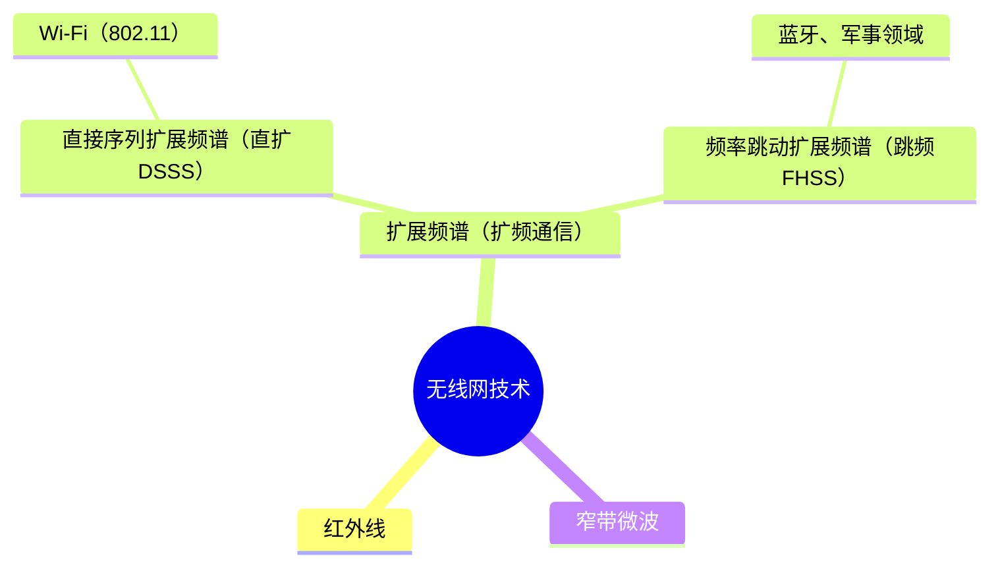
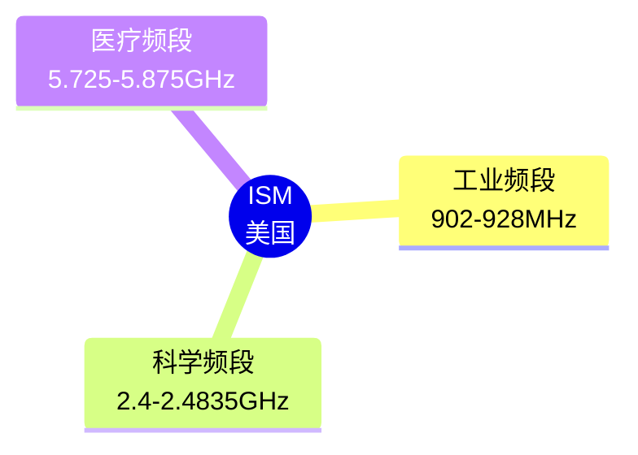

* 选择题考查==1～3分==，案例分析可能考查==填空==和==简答==
* 高频考点：802.11信道与频段、CSMA/CA、**无线网络优化、无线认证、无线配置步骤**
---
## 4.1 蜂窝移动通信系统
#### 移动通信制式

| 运营商       | 2G       | 3G           | 4G              | 5G        | 备注          |
| ------------ | -------- | ------------ | --------------- | --------- | ------------- |
| **中国移动** | GSM      | **TD-SCDMA** | TD-LTE          | SA 和 NSA | CDMA码分多址  |
| **中国联通** | GSM      | WCDMA        | TD-LTE、FDD-LTE |           | TD是时分复用  |
| **中国电信** | **CDMA** | CDMA2000     | TD-LTE、FDD-LTE |           | FDD是频分复用 |

<Callout title="TD-LTE-Advanced 是我国自主知识产权的4G标准，TD-SCDMA 为自主知识产权的3G标准" type="idea">

</Callout>

#### 移动通信技术标准
* WiMAX II属于4G标准。3G和4G最大的区别是，3G标准骨干网是基于**传统时分复用的语音网络**，而 4G骨干网是基于**IP的分组交换网络**。

| 标准   | 技术                                                          | 特点                               |
| ------ | ------------------------------------------------------------- | ---------------------------------- |
| **1G** | 蜂窝通信                                                      | 只能传语音                         |
| **2G** | GSM、CDMA、GPRS（2.5G）                                       | 可以传输少量数据                   |
| **3G** | CDMA2000（中国电信）、WCDMA（中国联通）、TD-SCDMA（中国移动） | 骨干网是基于==时分复用的语音网络== |
| **4G** | **LTE、UMB、WiMAX II**                                        | 骨干网是基于==IP的分组交换网络==   |
| **5G** | 统一技术标准，包含NSA/SA组网                                  | 大带宽、低时延、支持物联网海量接入 |

#### 4.1.1 CDMA 原理
* CDMA系统为不同用户分配码片，根据计算==正交值来判断是否接收数据和接收的数据是多少==。
  * ==正交结果为 1，表示发送数据 1，==
  * ==正交结果为 -1，表示发送数据为 0，==
  * ==正交结果为 0，表示未向该终端发送数据。==

#### 题目一
**假定在一个CDMA系统中，两个发送方发送的信号进行叠加，发送方1和接收方1共享的码片序列为：$(1, 1, 1, -1, 1, -1, -1, -1)$，发送方2和接收方2共享的码片序列为：$(1, -1, 1, 1, 1, -1, 1, 1)$。假设发送方1和发送方2发送的两个连续bit经过编码后的序列为：$(2, 0, 2, 0, 2, -2, 0, 0)$、$(0, -2, 0, 2, 0, 0, 2, 2)$，则接收方1接收到的两个连续bit应为（  ）。**
A. (1, -1) B. (1, 0) C. (-1, 1) D. (0, 1)

---

**计算与解析步骤：**

* **已知条件：**
* 接收方1共享的码片序列（向量 C_1）：(1, 1, 1, -1, 1, -1, -1, -1)
* 码片长度 $m = 8$
* 叠加后的接收总序列包含 2 个 bit（共 16 个数值）：
* 第 1 个 bit 的叠加序列 $S_1 = (2, 0, 2, 0, 2, -2, 0, 0)$
* 第 2 个 bit 的叠加序列 $S_2 = (0, -2, 0, 2, 0, 0, 2, 2)$

---

* **计算第 1 个 bit 的恢复值：**
将 $S_1$ 与 $C_1$ 进行规格化内积计算：

$$\begin{aligned}   S_1 \cdot C_1 &= (2 \times 1) + (0 \times 1) + (2 \times 1) + (0 \times -1) + (2 \times 1) + (-2 \times -1) + (0 \times -1) + (0 \times -1) \\   &= 2 + 0 + 2 + 0 + 2 + 2 + 0 + 0 \\   &= 8   \end{aligned}$$

除以码片长度 $m = 8$：

$$\mathrm{Orthogonal\ result} = \frac{8}{8} = 1$$

---

* **计算第 2 个 bit 的恢复值：**
将 $S_2$ 与 $C_1$ 进行规格化内积计算：

$$\begin{aligned}   S_2 \cdot C_1 &= (0 \times 1) + (-2 \times 1) + (0 \times 1) + (2 \times -1) + (0 \times 1) + (0 \times -1) + (2 \times -1) + (2 \times -1) \\   &= 0 - 2 + 0 - 2 + 0 + 0 - 2 - 2 \\   &= -8   \end{aligned}$$

除以码片长度 $m = 8$：

$$\mathrm{Orthogonal\ result} = \frac{-8}{8} = -1$$

---
根据正交结果为 1，表示发送数据 1，和正交结果为 -1，表示发送数据为 0，所以收到两个连续bit是 （1，0）

### 4.1.2 4G

* 候选 4G 标准有 3 个：**UMB**（Ultra Mobile Broadband）、**LTE**（Long Term Evolution）和 **WiMAX II**（IEEE 802.16m）。
* LTE（长期演进）是沿着 ==GSM --> W-CDMA --> HSPA --> 4G== 路线发展的技术，是由以欧洲电信为主的 3GPP 组织制定的。

* 中国移动、中国电信和中国联通均获得 ==TD-LTE 牌照==，中国移动获得了 130MHz 的频谱资源，远高于中国电信和中国联通的 40MHz。
* 各家运营商得到的商用频段划分如下：
  * (1) **中国移动**：1880～1900MHz、2320～2370MHz、2575～2635MHz。
  * (2) **中国联通**：2300～2320MHz、2555～2575MHz。
  * (3) **中国电信**：2370～2390MHz、2635～2655MHz。

#### 关键技术🌟🌟

* **4G关键技术包括：** **OFDMA**（Orthogonal Frequency Division Multiple Access）、**MIMO**（Multiple Input Multiple Output）、**软件无线电**（Software Defined Radio, SDR）技术、**VoIP**（Voice over Internet Protocol）技术等。
  * ==OFDMA技术🌟：== OFDMA技术是 4G 中的一种**多址技术**，通过将无线信道**分成多个子信道**来实现多用户之间的并行传输，**提高了频谱利用率和数据传输速率**。
  * ==MIMO技术：== MIMO技术是 4G 中的一种**天线技术**，通过使用**多个天线**来发送和接收数据，可以显著**提高无线信道的容量和数据传输速率**。
  * ==码本分集技术：== 码本分集技术是 4G 中的一种**编码技术**，通过在发送数据时**添加纠错码**来提高数据的可靠性，减少误码率，从而**提高数据传输速率和通信质量**。
  * ==软件无线电技术：== 通过软件定义无线电设备的**信号处理、调制解调、信道估计**等功能，可以实现高度灵活的无线通信系统，提高了系统的**可扩展性和适应性**。
  * ==VoIP技术：== VoIP技术是 4G 中的一种**语音通信技术**，通过将语音数据转换成数字信号进行传输，实现了语音和数据在同一网络上的传输，**提高了通信效率和资源利用率**。
  * ==安全加密技术：== 4G 中的安全加密技术主要包括**身份认证、数据加密、安全传输**等，通过使用密码学算法等技术保障数据的**安全性及用户的隐私**。

#### OFDMA
- Orthogonal Frequency Division Multiple Access
  * ==高频谱效率：== OFDMA技术可以**将一个频段分成多个子载波，每个子载波都可以独立地传输数据**，提高了频谱利用率。
  * ==低功率消耗：== 由于OFDMA技术使用了正交频分多址技术，降低了同频干扰，因此可以通过降低传输功率来实现能耗的降低。
  * ==抗干扰能力强：== OFDMA技术可以采用**频率**、**时间**和**空间**上的多重保护技术，以提高系统的抗干扰能力。
  * ==支持多用户：== OFDMA技术可以将**一个频段分成多个子载波**，使得**多个用户可以同时通过不同的子信道进行通信**，提高了系统容量。

* LTE系统采用了OFDMA技术作为**下行链路的多用户调制技术**，以提高系统容量和频谱利用率。
* **WiMAX系统**也采用了OFDMA技术作为其物理层的多用户调制技术。

#### MIMO
- Multiple Input Multiple Output
  - MIMO技术利用多个天线同时传输和接收信号，增加了信道的自由度，能够==显著提高频谱利用率和信道容量，提高数据传输的可靠性和覆盖范围==。
  * MIMO技术主要有两种形式：**空时编码（Space Time Coding, STC）**和**空间复用（Spatial Multiplexing, SM）**。
    * ==空时编码：== 指在发送端将多个数据流分别编码成多个符号，通过多个天线同时发送，接收端则利用接收到的符号进行解码，从而**提高信道的可靠性和传输速率**。
    * ==空间复用：== 指利用多个天线同时发送不同的数据流，接收端通过接收到的多个数据流进行解码，从而**提高频谱利用率和传输速率**。

#### SDR
- Software Defined Radio
  * 软件定义无线电（SDR）技术允许无线电设备中的==硬件和软件分离==，通过软件可编程的方式实现无线电通信，提高通信系统的==灵活性和可靠性==，同时也可以**降低**通信系统的==成本和维护难度==
  * SDR技术主要用于实现基站设备和终端设备的软件定义，使它们能够在**不同频段和协议之间进行无缝切换**，并支持不同的通信服务，如数据、语音和视频等。
  * **SDR关键功能：**
    * ==多模式支持：== 由于 4G 支持多种制式，采用软件定义无线电技术可以方便地实现多模式支持，使得设备具备更加广泛的应用范围。
    * ==多天线技术：== 软件定义无线电技术可以实现对多天线技术的支持，从而可以提高通信系统的传输速率和容量。
    * ==动态频谱接入技术：== 软件定义无线电技术可以实现对动态频谱接入技术的支持，使得设备可以更加灵活地使用频率资源。
    * ==自适应调制技术：== 软件定义无线电技术可以实现对自适应调制技术的支持，从而可以根据不同的信道条件选择最合适的调制方式，提高通信系统的传输效率。

#### VoIP
- Voice over Internet Protocol
  * VoIP技术是 4G 中的一种语音通信技术，通过将语音数据转换成数字信号进行传输，实现了语音和数据在同一网络上的传输，==提高了通信效率和资源利用率==。
    * VoIP技术通过 ==IMS 系统==实现了语音信号的数字化和封装，使其能够在 IP 网络中进行传输。
    * VoIP技术的优点在于能够==大幅降低通话费用==、==提高语音质量==、==提供更多的增值业务==和==更加便利==的使用方式。
    * VoIP技术还可以支持多种网络接入方式，包括 3G、4G、Wi-Fi、有线网络等。

### 4.1.3 5G
* ==(1) 高带宽（eMBB）：== 支持 20Gbps 峰值速率，适用于 3D、AR/VR 等应用，提升用户体验。
* ==(2) 低时延高可靠（uRLLC）：== 支持超低时延高可靠通信，5G 可以提供小于 1ms 的端到端时延以及 99.9999% 的可靠性保障。
* ==(3) 海量终端互联（mMTC）：== 侧重于人与物之间的信息交互，主要场景包括车联网、智能物流、智能资产管理等，要求提供多连接的承载通道，实现万物互联。

#### 5G 组网技术 SN/NSA

* NSA在==原4G基站上搭载5G==，节约建设资源、减少建设时间、快速进入5G时代。
* SA单独组建5G基站，更好的网络体验、更炫酷的应用场景。

#### 关键技术🌟🌟
* **5G关键技术包括：** 超密集异构无线网络、大规模输入输出（MIMO）、毫米波通信、软件定义网络和网络功能虚拟化。
  * ==超密集异构无线网络：== 相对于 4G 网络，5G 使用较高的频谱，覆盖范围相对较小，需要密集部署宏基站、微基站和室分等不同架构的网络满足覆盖需求。
  * ==大规模输入输出（MIMO）：== 5G 沿用了 4G 网络的多进多出技术（Multiple Input Multiple Output, MIMO），能有效提升网络带宽。
  * ==毫米波通信：== 毫米波小基站可以增强高速环境下用户的网络体验，提升网络的组网灵活性。
  * ==SDN和NFV🌟🌟：==
    * SDN 技术实现==控制层面==和==数据层面==分离，提升网络灵活性、可管理性和扩展性。
    * NFV 技术可以实现==软件==和==硬件==解耦，比如传统网络需要购买防火墙、入侵检测、防病毒等硬件安全设备，NFV 实现网络功能虚拟化后，只需要购买标准服务器，然后虚拟出多台虚拟机，可以在虚拟机上运行软件的虚拟防火墙（vFW）、虚拟机入侵检测（vIPS）和虚拟防病毒（vAV），从而大幅降低网络的建设和维护成本。

## 4.2 无线局域网

### 4.2.1 WLAN 通信技术
* 无线网主要使用三种通信技术：==红外线==、==扩展频谱（扩频）==和==窄带微波技术==
  * 扩展频谱通信：将信号散步到更宽的带宽上以==减少发送阻塞和干扰==的机会。
  * WLAN主要使用扩展频谱技术：==频率跳动扩频 FHSS（蓝牙）==和==直接序列扩展频谱 DSSS（Wi-Fi）==

#### 技术关系

#### 802.11 技术标准对比

| 参数 / 标准      | 802.11    | 802.11b         | 802.11a         | 802.11g         | 802.11n             | 802.11ac(Wi-Fi5)  | 802.11ax(Wi-Fi6)  | 802.11be(Wi-Fi7) |
| ---------------- | --------- | --------------- | --------------- | --------------- | ------------------- | ----------------- | ----------------- | ---------------- |
| **标准发布时间** | 1997      | 1999            | 1999            | 2003            | 2009                | 2012              | 2018              | 2024             |
| **频率范围**⭐️   | 2.4GHz    | 2.4GHz          | 5GHz            | 2.4GHz          | 2.4GHz5GHz          | 5GHz              | 2.4GHz5GHz        | 2.4GHz5GHz       |
| **非重叠信道**   | 3         | 3               | 5               | 3               | 3+5                 | 5                 | 3+5               | 多               |
| **调制技术**     | FHSS/DSSS | CCK/ DSSS       | OFDM            | CCK/OFDM        | OFDM                | OFDM              | OFDMA             | OFDMA            |
| **最高速率**     | 2M        | 11M             | 54M             | 54M             | ==600M==⭐️          | ==6900M==⭐️       | ==9600M==⭐️       | ==30G/46G==⭐️    |
| **实际吞吐**     | 200K      | 5M              | 22M             | 22M             | 100+M               | 900M              | 1G以上            | 1G以上           |
| **兼容性**       | N/A       | 与11g产品可互通 | 与11b/g不能互通 | 与11b产品可互通 | 向下兼容802.11a/b/g | 向下兼容802.11a/n | 向下兼容802.11a/n | 向下兼容         |

1. **Wi-Fi标准的工作频段：**
  * **2.4GHz：** ==802.11、802.11b和802.11g==
  * **5GHz：** ==802.11a和802.11ac==
  * **2.4GHz + 5GHz：** ==802.11n/ax/be==
2. **非重叠信道数量：** 2.4GHz频段包含13个信道，有3个不重合信道，常用信道为**1、6和11**，不重合信道间隔5个信道。
3. **不同802.11标准的最大速率：** 比如，**802.11n最大支持600Mbps**，802.11ax速率可达9600Mbps。

### 4.2.2 WLAN 频谱与信道
#### WLAN 网络分类
* WLAN网络可以分为三类：==基础无线网络==、==Ad Hoc网络==和==分布式无线系统==。
  * 基础无线网络(Infrastructure Networking)：用户通过无线接入点AP接入。
  * 特殊网络(Ad Hoc Networking)：用于军用自组网或寝室局域网联机游戏。
  * 分布式无线系统：通过AC控制大量AP组成的无线网络。

#### ISM 频段

* ISM频段主要是开放给==工业==、==科学==、==医学==机构使用，该频段是依据美国联邦通讯委员会（FCC）所定义出来，并没有所谓使用授权的限制。

#### 不重叠信道
- 2.4G 频段
  - ==13个信道==, 3个不重叠信道(==1、6、11==)
   
- 5G + 5.8G 频段
  - 中国的5.8G Hz 信道有5个非重叠信道, 分别为: 149、153、157、161、165
  

#### 2.4G 和 5GHz 频段

- 2.4G 相邻信道中心频率间隔为 ==5MHz==
- 5G 相邻信道中心频率间隔为 ==20MHz==

#### Wi-Fi7 (802.11be)
* 5GHz频段：信道中心频率间隔为==20MHz==。Wi-Fi 7是最新一代的无线局域网标准，旨在显著提高Wi-Fi的性能和效率。以下是Wi-Fi 7的一些关键特性：
  * ==更高的吞吐量==⭐️：支持==320MHz==的超宽频信道，理论上可以达到==46Gbps==。
  * ==增强的调制方式==：采用了==4096QAM==调制技术，比Wi-Fi 6的1024QAM提升了20%的传输速率。
  * ==多链路操作（MLO）==：MLO支持更高效的链路间**负载均衡**，从而提高吞吐量和可靠性。
  * ==改进的延迟特性==：改进了对确定性延迟的支持，使其在高交互性应用（如增强现实和虚拟现实）中表现更佳。
  * ==频谱效率==：允许多个**资源单元（RUs）分配给单个STA**，提高了频谱资源调度的灵活性和效率。
  * Wi-Fi 7能够提供==更高的带宽==、==更低的延迟==和==更高的可靠性==，特别适用于需要高吞吐量和低延迟的应用，如**超高清视频流、沉浸式3D训练和AR/VR/XR。**
   
#### 802.11 MAC层
* 802.11 MAC子层定义了3种访问控制机制：CSMA/CA（支持竞争访问），RTS/CTS和点协调功能（支持无竞争访问）。
  * ==CSMA/CA==核心原理：发送数据前先检测信道是否使用，若信道空闲，则等待一段随机时间后，发送数据。所有终端都遵守这个规则，故这个算法对参与竞争的终端是公平的，按**先来先服务**的顺序获得发送机会。
  * ==RTS/CTS信道预约==：发送前先打报告，其他终端记录信道占用时间。
  * ==PCF点协调功能==：由AP集中轮询所有终端，将发送权限轮流交给各个终端，类似令牌，拿到令牌的终端可以发送数据，没有令牌的终端则等待。点协调功能比DCF分布式协调优先级更高。（无争用）

#### 隐藏节点问题
* 为什么无线网络不沿用有线网络的**CSMA/CD**，而提出**CSMA/CA**来解决冲突问题？
  * 原因：有线网络中所有终端直接连接起来，可以非常容易检测到其他终端有没有发送数据（收发数据有线链路上会有**光电脉冲变化**）。无线网络终端**没有线缆连接**，**可能检测不到冲突**，最典型的就是==隐藏节点==（也叫==隐蔽终端==）问题。如下图所示，**A和C互为隐藏节点**。
 

#### 802.11 三种帧间间隔⭐️⭐️
* DIFS (分布式协调IFS)：最长的IFS，==优先级最低==，用于==异步帧竞争访问的时延。==
* PIFS (点协调IFS)：中等长度的IFS，==优先级居中==，在PCF操作中使用。
* SIFS (短IFS)：最短的IFS，==优先级最高==，用于需要立即==响应的操作==（==确认ACK==）。

#### 帧间间隔用途⭐️⭐️
* CSMA/CA中，数据要发送，就监听信道是否空闲。如果信道空闲，等待 ==DIFS== 时段后开始发送。
* AP收到一个数据帧后等待==SIFS==再发送一个应答帧(ACK)。
* SIFS用于RTS/CTS：源终端先发送一个“请求发送”帧RTS，目标终端收到RTS后等待一个==SIFS==时间，然后发送“允许发送”帧CTS。
* RTS/CTS后，发送数据前等待==SIFS==。

* 网络分配矢量(Network Allocation Vector, NAV)信号，该信号的存在说明==信道忙==，**所有终端不得争用信道**。

### 4.2.4 移动Ad Hoc网络
* AD Hoc网络是由无线移动节点组成的==对等网==，不需要AP/基站等网络基础设施，==每个节点既是主机==，==又是路由节点==，是一种MANET(Mobile Ad Hoc Network)网络。
* Ad Hoc来自拉丁语，具有“即兴，临时”的意思。

#### MANET网络的特点
1. 网络拓扑结构动态变化的，==不能使用传统路由协议==。
2. 无线信道提供的带宽较小，==信号衰落和噪声干扰的影响却很大==。
3. 无线终端携带的==电源能量有限==。
4. 容易招致网络窃听、欺骗、拒绝服务等==恶意攻击的威胁==。

#### MANET路由协议
* 根据路由策略可分为==表驱动的路由协议==和==源路由协议==；
* ⭐️根据网络结构可分为==扁平的路由协议==、==分层的路由协议==和==基于地理信息的路由协议==；
  * 表驱动的路由协议和源路由协议都是**扁平的路由协议**。
  * 目标排序的距离矢量(Destination-Sequenced Distance Vector,==DSDV==)协议是一种==扁平式==路由协议。它是由传统的Bellman-Ford算法改进的==距离矢量协议==，利用序列号机制解决了路由环路问题。
  * 按需分配的距离矢量(Ad-hoc On-demand Distance Victor,==AODV==)协议也是一种==扁平式==路由协议，但是采用了反应式路由策略。这是一种==距离矢量协议==，适用于组播网络。

#### 4.2.5 WLAN 安全技术⭐️⭐️
* (1) SSID访问控制：隐藏SSID，让不知道的人搜索不到。
* (2) 物理地址过滤：在无线路由器设置MAC地址黑白名单。
* (3) WEP认证和加密：==PSK预共享==密钥认证，==RC4加密==。
* (4) WPA (802.11i草案)
  * 认证：802.1x。
  * 加密：==RC4 (增强) +TKIP== (临时密钥完整协议，动态改变密钥) 支持==完整性认证和防重放攻击==。
* (5) WPA2 (802.11i)
  * 针对WPA优化，加密协议是==由RC4变为基于AES的CCMP==⭐️。
* (6) 无线认证技术：对安全性要求高的（比如研发、办公），采用==802.1x==；对便捷性要求高（比如访客），采用==Portal认证==；哑终端（比如打印机）采用==MAC认证==。

#### WEP和WPA扩展
* WEP包括==共享密钥认证==和==数据加密==两个过程，前者使得没有正确密钥的用户无法访问网络，后者则要求所有数据都必须用密文传输。
* 最初WEP使用==24位的初始向量==，加上40位的字符串，构成==64位的WEP密钥==。后来美国政府放宽了出口密钥长度的限制，允许使用104位的字符串，加上24位的初始向量，构成==128位的WEP密钥==。
  * WEP不安全：**密码太短，IV可能雷同**。

* WPA包含了==认证==、==加密==和==数据完整性校验==3个组成部分。
  - (1) 使用==802.1x协议==对用户的MAC地址==进行认证==；
  - (2) 增大了==密钥==和==初始向量==的长度，以==128位的密钥==和==48位的初始向量(IV)==用于RC4加密。WPA还采用==TKIP==，通过==更频繁地变换密钥==来减少安全风险。
  - (3) WPA强化了==数据完整性保护==。使用报文完整性编码来检测伪造的数据包，并且在报文认证码中包含有**帧计数器，还可以防止重放攻击**。

## 4.3 无线个人网
### 4.3.1 蓝牙和Zigbee
* 无线个人网（Wireless Personal Area Network, WPAN），覆盖半径==10m==左右。
* 蓝牙技术（Bluetooth）最早被开发用于实现不同工业领域间的协调工作，现在被广泛应用于人们的生活各个领域，比如电脑与手机间的车机互联、蓝牙耳机与手机的互联等。
  * 2001年，蓝牙被确定为==IEEE 802.15.1==。使用==2.4GHz==进行通信，采用==跳频通信技术（FHSS）==，数据速率为==1Mbps==。目前蓝牙5.3速率可达48Mbps，考试仍以1Mbps为准。

* Zigbee基于==IEEE 802.15.4==，它瞄准了==速率更低==、==距离更近==、==更省电的无线个人网==。Zigbee适用于固定的、手持的或移动的电子设备，这些设备一般使用电池供电，电池寿命可以长达几年，通信速率可以低至==9.6kbps==，从而可以实现低成本无线通信。Zigbee具有良好的安全机制，网络层和MAC层都采用==高级加密标准AES==，同时结合了==加密和认证功能的CCM*算法==。目前Zigbee被广泛应用于智能家居和医疗监护等场景。
  * 智能家居：如电灯、电视机、冰箱、洗衣机、电脑、空调等。
  * 医疗监护：如脉搏、血压、呼吸监测。

#### Zigbee 设备

* IEEE 802.15.4定义的低速无线个人网(Low Rate-WPAN)包含两类设备：==全功能设备==(Full-Function Device, FFD)和==精简功能设备==(Reduced-Function Device, RFD)。
  * FFD有3种工作模式，可以作为==一般的设备==、==协调器(Coordinator)==或==PAN协调器==。
  * RFD功能简单，只能作为设备使用，例如电灯开关、被动式红外传感器等，这些设备不需要发送大量的信息，通常接受某个FFD的控制。
  * FFD可以与RFD或其他FFD通信，而RFD只能与FFD通信，==RFD之间不能互相通信==。

#### Zigbee底层技术

* MAC子层提供两种信道访问方式：基于==竞争的访问==和==无竞争的访问==。
* 基于竞争的访问方式应用了==CSMA/CA==后退算法。
* 对于低延迟的应用或者要求特别带宽的应用，==PAN协调器要为其分配保障时槽==(Guaranteed Time Slots, GTS)，在保障时槽内可以进行无竞争的访问。
* ZigBee采用的路由算法是按需分配的**距离矢量协议(AODV)**。
* ZigBee的网络层和MAC层都使用高级加密标准(AES)，以及结合了==加密和认证功能的CCM*分组加密算法==。分组加密也称块加密(Block Cipher)，其操作方式是将明文按照分组算法划分为==128位的区块==，对各个区块分别进行加密，整个密文形成一个密码块链。
